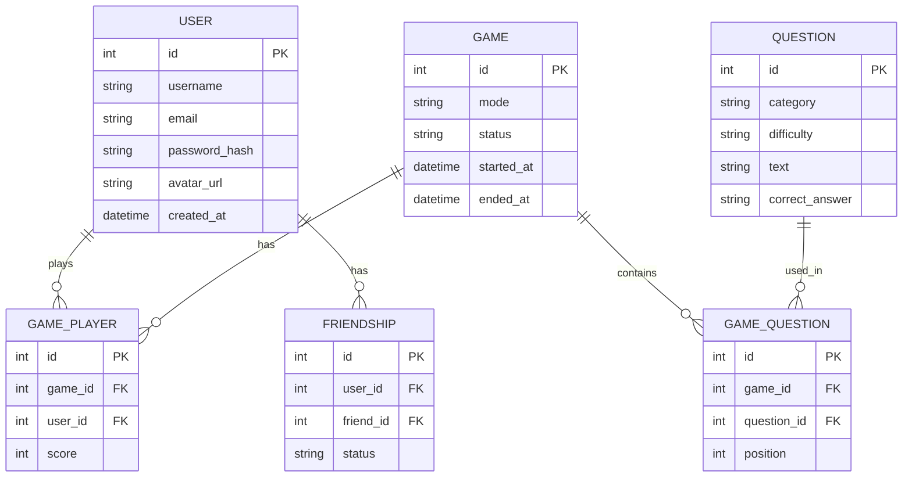

*This project has been created as part of the 42 curriculum by rafeger, thhuynh, jodde, lzannis, ankim .*
 
# <Project Name> — ft_transcendence
 
> One-line pitch: e.g. *A real-time multiplayer quiz web application powered by the Open Trivia Database.*
 
---
 
## Table of Contents
 
1. [Description](#description)
2. [Instructions](#instructions)
3. [Team Information](#team-information)
4. [Project Management](#project-management)
5. [Technical Stack](#technical-stack)
6. [Database Schema](#database-schema)
7. [Features List](#features-list)
8. [Modules](#modules)
9. [Individual Contributions](#individual-contributions)
10. [Resources](#resources)
11. [License & Credits](#license--credits)
---
 
## Description
 
### Overview
 
 
**<Project Name>** is a web-based quiz platform built for the ft_transcendence project at 42 Paris.
Players can <...>. Questions are sourced from the [Open Trivia Database (OpenTDB)](https://opentdb.com/).


### Goal
 
<!-- The objective of the project, both from the subject's point of view and the team's. -->
 
### Key Features
 
- <!-- e.g. User accounts & authentication -->
- <!-- e.g. Solo and multiplayer quiz games -->
- <!-- e.g. Real-time matches -->
- <!-- e.g. Leaderboards & stats -->
- <!-- e.g. Friends / chat -->


mettre des screens pour chaque truc mentionne au dessus .


### Configuration (`.env`)
 
Copy the example file and fill in the values:
 
```bash
cp .env.example .env
```
 
| Variable | Description | Example |
|----------|-------------|---------|
| `DB_HOST` | Database host | `db` |
| `DB_NAME` | Database name | `transcendence` |
| `DB_USER` | Database user | `<user>` |
| `DB_PASSWORD` | Database password | `<secret>` |
| `JWT_SECRET` | Secret used to sign tokens | `<secret>` |
| `<OTHER_VAR>` | <...> | <...> |
 
> ⚠️ Never commit the `.env` file. Only `.env.example` is versioned.
 
### Installation & Run
 
```bash
# 1. Clone the repository
git clone git@github.com:rafeger/Transcendance.git
cd Transcendance

lister la suite des infos
 


 # 4. Open the app
# https://localhost:<port>
```


### Useful commands

- make              🚀 build and start the project
- make dev          🚀 build and start the project in dev mode
- make down$        🛑 stop containers (keep data)
- make down-dev     🛑 stop containers dev (keep data)
- make fclean       🧹 remove containers, images and volumes
- make fclean-dev   🧹 remove dev containers, images and volumes
- make re           🔄 fclean + make
- make re-dev       🔄 fclean-dev + make dev
- make debug        🔍 status + last logs of each service
- make debug-dev    🔍 status + last logs of each service
- make logs         📜 follow all logs
- make logs-dev     📜 follow all  dev logs


## Team Information
 
| Login | Role(s) | Responsibilities |
|-------|---------|------------------|
| rafeger | <PO / PM / Tech Lead / Dev> | <...> |
| <login2> | <role> | <...> |
| <login3> | <role> | <...> |
| <login4> | <role> | <...> |
| <login5> | <role> | <...> |
 
---

### Work organization
 
<!-- How tasks were split (by feature / by layer), sprint length, deadlines, meeting rhythm, code review policy... -->
 
- **Task distribution:** <...>
- **Meetings:** <frequency, format>
- **Git workflow:** <branching strategy, PR reviews, naming conventions>
### Tools
 
- **GitHub Issues / Projects** — task tracking, one issue per feature, assigned to a member
 

 ### Frontend
 
- <framework / language> — <why>
### Backend
 
- <framework / language> — <why>
### Database
 
- **<DBMS>** — <why this choice>
### Other technologies & libraries
 
- **OpenTDB API** — question source
- <WebSockets lib, auth lib, reverse proxy, etc.>
- **Docker / Podman** — containerization
### Justification of major technical choices
 
<!-- Explain trade-offs: why this framework over another, constraints of the subject, team experience, etc. -->
 
---


## Database Schema
 
<!-- Replace with your real schema. Mermaid renders natively on GitHub. -->




### Tables / relationships
 
| Table | Description | Key fields |
|-------|-------------|------------|
| `user` | <...> | <...> |
| `game` | <...> | <...> |
| <...> | <...> | <...> |
 
---
 
## Features List
 
| Feature | Description | Member(s) |
|---------|-------------|-----------|
| <Authentication> | <...> | <login> |
| <Quiz game (solo)> | <...> | <login> |
| <Multiplayer> | <...> | <login> |
| <Leaderboard> | <...> | <login> |
| <...> | <...> | <...> |
 
---
 
## Modules
 
| Module | Type | Points | Member(s) |
|--------|------|--------|-----------|
| <Module name> | Major | 2 | <login> |
| <Module name> | Minor | 1 | <login> |
| <Module of choice> | Major/Minor | <2/1> | <login> |
| **Total** | | **<N>** | |
 
### Module details
 
#### <Module name> (Major / Minor)
 
- **Why:** <justification — mandatory for "Modules of choice">
- **Implementation:** <how it was implemented>
- **Member(s):** <login>
<!-- Repeat for each module -->
 
---
 
## Individual Contributions
 
### rafeger
 
- **Contributed to:** <features / modules / components>
- **Challenges & solutions:** <...>
### thhuynh
 
- **Contributed to:** <...>
- **Challenges & solutions:** <...>
### jodde
 
- **Contributed to:** <...>
- **Challenges & solutions:** <...>
### lzannis
 
- **Contributed to:** <...>
- **Challenges & solutions:** <...>
### ankim
 
- **Contributed to:** <...>
- **Challenges & solutions:** <...>
---


## Resources
Credit OpenTDB (licence CC BY-SA 4.0): for all questions used on our site, we took using API technology from OpenTDB. 
 
### References
 
- [Open Trivia Database — API documentation](https://opentdb.com/api_config.php)
- [Docker documentation](https://docs.docker.com/)
- [Podman documentation](https://docs.podman.io/)
- <framework docs>
- <articles / tutorials>